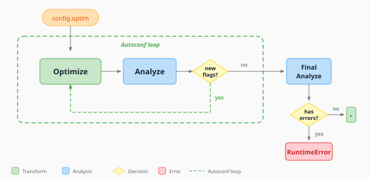

# Analyze and optimize

An ONNX graph can be valid without running efficiently on the execution provider (EP) you intend to use. Windows ML CLI separates compatibility analysis from graph transformation so you can inspect a problem before changing the model.

## What analyze does

`winml analyze` checks graph operators and recognized subgraphs against available EP rules. Specify `--ep` and `--device` to analyze a known target, or use `all` to examine rule-backed targets without selecting a single local device.

```powershell
winml analyze -m .\model.onnx --ep qnn --device npu --output .\analysis.json --optim-config .\optim.json
```

Static analysis doesn't run the complete model. Its findings depend on the coverage and version of the rules. A successful analysis isn't a substitute for compiling, running, and evaluating the full graph on the target device.

### How operators are classified

| Classification | How to interpret it |
|---|---|
| Supported | The available rules recognize this operator or pattern as supported for the analyzed target. |
| Partial | Support is conditional or incomplete. Read the finding for the relevant constraints or transformation. |
| Unsupported | The analyzed target doesn't support the reported form according to the available rules. |
| Unknown | The analyzer doesn't have enough information to establish support. |

Don't equate these classifications with CPU fallback behavior. Whether a full session can partition the graph across providers is a separate runtime question. Review the operator's type, shape, precision, domain, and provider-specific explanation.

### Two key outputs: lint and autoconf

The compatibility findings describe the graph as it is. Optimization recommendations suggest transformations that may improve support or reduce unnecessary work.

Use `--output` to save the complete analysis and `--optim-config` to save recommended optimizer settings. `--information` controls detailed recommendations; `--no-information` requests a smaller compatibility-focused report. For automation, prefer the JSON output over console text.

Recommendations are candidates to validate, not guarantees of better performance or unchanged accuracy.

### Local op execution

With `--run-unknown-op`, the analyzer can probe unknown operators using the local runtime and EP. This requires the relevant provider and hardware; it isn't an offline substitute for missing rules on a machine without that target.

Keep this option disabled when you only need static analysis. Even a successful operator probe doesn't exercise every interaction in the complete graph.

## What optimize does

`winml optimize` applies configured graph transformations, such as constant folding and compatible fusions. To discover the capabilities exposed by the installed version:

```powershell
winml optimize --list-capabilities
winml optimize --list-rewrites
```

To inspect which transformations would apply without writing a new model:

```powershell
winml optimize -m .\model.onnx --ep qnn --device npu --check-optim
```

Use the same target for analysis and optimization. Some fusions introduce provider-specific operators; don't assume CPU-oriented transformations are also appropriate for an NPU.

## The analyzer/optimizer loop



Apply the recommended configuration to a new output file, then analyze it again:

```powershell
winml optimize -m .\model.onnx -c .\optim.json --ep qnn --device npu -o .\model_optimized.onnx
winml analyze -m .\model_optimized.onnx --ep qnn --device npu --output .\optimized_analysis.json
```

`winml build` coordinates this feedback loop for configured workflows. `--max-optim-iterations` limits re-optimization rounds; `--no-analyze` disables the analyzer loop, while `--no-optimize` disables graph optimization. Standalone `winml optimize` applies its selected transformations rather than running the entire build workflow.

Keep the original graph. Compare output similarity and task accuracy, then benchmark the optimized candidate. Node-count reduction alone doesn't demonstrate faster inference.

## See also

- [Analyze command](../commands/analyze.md)
- [Optimize command](../commands/optimize.md)
- [Evaluate model quality](evaluation-datasets.md)
- [Measure performance](performance-monitoring.md)
