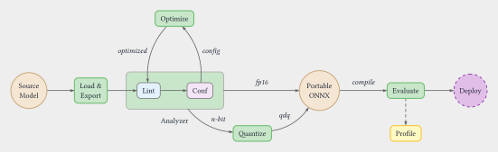

# How Windows ML CLI Works

Windows ML CLI is a toolkit for converting supported models built with
[PyTorch](https://docs.pytorch.org/docs/stable/index.html), including models from the
[Hugging Face Hub](https://huggingface.co/docs/hub/models-the-hub), into
[ONNX](model-graphs.md) model files. It prepares these files for Windows ML
[execution providers (EPs)](execution-providers-devices.md), the runtime components that run
model operations on particular hardware targets. Starting from a
model identifier or a pre-exported ONNX file, Windows ML CLI runs a staged pipeline — export,
optimize, quantize, compile — and produces a final `model.onnx` ready for inference via
a Windows ML session. Inference means running the model on input data to produce results.

Each stage is independently controllable. Quantization and compilation are optional and
can be bypassed with a flag or by leaving the corresponding section of the build
configuration empty. The same pipeline API that powers `winml build` is also the
programmatic entry point for `WinMLAutoModel.from_pretrained()`.

## The Pipeline at a Glance



The stages run in order, and each one writes an intermediate ONNX file to the output
directory. All intermediate artifacts are preserved so you can inspect any stage's output
or feed a pre-processed file into a later stage directly.

## Pipeline Stages

### Export — `winml export`

`winml export` loads a Hugging Face model (pretrained or random-weight), traces it with
the configured exporter and writes an ONNX graph. Precision, operator
decomposition, and supported targets depend on the source model and export settings.
Tracing captures the model's calculation steps for conversion; operator decomposition
expresses a step as simpler operations. See [Load and export](model-loading-export.md)
for an introduction to the available exporters.

### Analyze — `winml analyze`

`winml analyze` performs static compatibility analysis on an ONNX graph against a target
execution provider. It classifies every node as Supported, Partial, Unsupported, or
Unknown — without running the model on the device. Use it before building to check if
your model (or an intermediate artifact from any pipeline stage) will run cleanly on the
target EP:

```powershell
winml analyze -m model.onnx --ep qnn --device npu
```

Add `--optim-config optim.json` to output auto-discovered optimization recommendations
that can be fed directly into `winml optimize`. The same analyzer also drives the
autoconf feedback loop inside `winml build`.

### Optimize — `winml optimize`

`winml optimize` runs graph-level transformations on the exported ONNX: operator fusion
(attention, layer norm, GeLU), constant folding, and graph pruning. The optimize stage
participates in an autoconf loop coordinated by `build`: a static analyzer inspects the graph for nodes that the
target EP cannot dispatch natively, and re-runs optimization with adjusted fusion flags
until no further improvements are found (up to a configurable iteration limit).

### Quantize — `winml quantize`

`winml quantize` reduces numerical precision to change model size, memory use, or execution
cost, potentially affecting accuracy. It supports 16-bit floating-point (FP16) conversion,
4-bit integer (INT4) round-to-nearest (RTN) weight-only quantization, dynamic quantization,
and calibrated static quantization using quantize/dequantize (QDQ) nodes.
See [Model precision and quantization](quantization.md) for these options and their
tradeoffs. Only static calibration requires representative samples.

The build workflow can detect pre-quantized inputs and
skip incompatible transformations; don't assume that every standalone conversion
is safe to repeat on an already-quantized graph.

### Compile — `winml compile`

`winml compile` invokes an EP-specific compiler (for example, the Qualcomm QNN compiler
for neural processing unit (NPU) targets) to embed a pre-compiled binary cache inside
the ONNX graph as an EPContext node, which lets the provider reuse compiled model data.
At inference time, the EP loads the cached binary directly, bypassing per-session
compilation work. Compilation is optional and off by default for auto-generated
recipes. An uncompiled ONNX graph still needs compatible operators, precision,
and shapes on the selected runtime.

### Perf and Eval — `winml perf` / `winml eval`

After the model is built, `winml perf` benchmarks inference latency and throughput using
a Windows ML session, and `winml eval` runs task-specific accuracy evaluation. Neither
command modifies the model; they consume the final `model.onnx` produced by the pipeline.

## `winml build` as the One-Shot Wrapper

Running each stage individually is useful when iterating on a specific step, but the
normal workflow is `winml build`, which orchestrates the full pipeline in a single
command:

```powershell
winml build -m microsoft/resnet-50 -o output/
```

The `-c config.json` flag is optional. If omitted, `winml build` auto-generates a
default config internally. To customize pipeline settings, generate a config first
with `winml config` and then pass it:

```powershell
winml config -m microsoft/resnet-50 -o config.json
winml build -c config.json -m microsoft/resnet-50 -o output/
```

`winml build` auto-detects whether the input is a Hugging Face model ID or an existing
ONNX file and calls the appropriate internal API (`build_hf_model` or `build_onnx_model`).
When given an ONNX file directly, the export stage is skipped and the pipeline starts at
optimize.

Individual stages can be bypassed from the command line without editing the config file:

```powershell
# Skip quantization and compilation
winml build -m bert-base-uncased -o output/ --no-quant --no-compile

# Skip optimization (for pre-quantized input)
winml build -m model_qdq.onnx -o output/ --no-optimize
```

## Configuration: `WinMLBuildConfig` vs CLI Flags

Pipeline behavior is primarily governed by a `WinMLBuildConfig` JSON file generated by
`winml config`. The config is a hierarchical structure with one section per stage:

```text
WinMLBuildConfig
├── loader    — model type, task, input constraints
├── export    — input tensor specs, opset, backend
├── optim     — fusion flags, optimization level
├── quant     — precision, calibration settings (null = skip stage)
├── compile   — target EP, device (null = skip stage)
└── eval      — evaluation settings
```

Setting `quant` or `compile` to `null` in the JSON file is equivalent to passing
`--no-quant` or `--no-compile` on the command line; both result in the corresponding
stage being skipped. CLI flags override the config at runtime without modifying the file,
which is convenient for one-off experiments.

The config file is written (or updated) to the output directory after the optimize stage
completes, capturing any autoconf-adjusted fusion flags so the build is reproducible.
This persisted `winml_build_config.json` records the recipe that
you can check into version control and run in CI/CD (`winml build -c winml_build_config.json -m <model> -o output/`) for repeatable, unattended builds across environments.

Record source revisions, calibration inputs, and dependency versions as well; the
JSON alone doesn't guarantee identical outputs. See [Build configuration](../reference/index.md).

## See Also

- [winml build](../commands/build.md) — full reference for the build command
- [winml export](../commands/export.md) — export command reference
- [ONNX and Execution Providers](execution-providers-devices.md) — background on EPs and the ONNX runtime
- [Config and build](configuration-build.md) — detailed field-by-field config documentation
